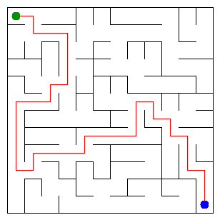

# Assignment 3. Maze Escape

**Student ID:** 250925  
**Name:** Ali Tulindinov  
**Group:** SE2511 
**Maze size (rows x columns):** 12 x 12

## Program output

The 13 lines printed by `java -cp out Main` on my personal data:

```text
Broken: 143
Kept: 121
Last broken wall: 251
MST cost: 37842
Heaviest broken wall: 776
Path length: 36
DFS visited: 97
Dead ends: 41
Zones: 8
Largest zone: 33
Is DAG: 0
Flow stages: 4
Fastest route cost: 9
```

## My maze



## Questions

### Mission 0. What do find and union do, and what makes them fast in your code?

`find` returns the representative of the set containing an element. `union` joins two different sets using their representatives. The implementation is fast because it uses path compression and union by size.

### Mission 1. Why is Broken always R*C - 1, and Kept always (R-1)*(C-1)?

A maze with R*C cells needs exactly R*C - 1 broken walls to connect all cells without creating cycles. The remaining walls are kept, so their number is (R-1)*(C-1) for this grid.

### Mission 2. My MST cost from Kruskal and from Prim, and why they are equal:

Both Kruskal and Prim give an MST cost of 37842 on my data. They use different approaches, but both find a minimum spanning tree, so the total minimum cost is equal.

### Mission 3. Why is there exactly one path between two cells? How did you avoid a stack overflow on a huge maze?

The broken walls form a tree: every cell is connected, and there are no cycles. Therefore, there is exactly one path between any two cells. I used an explicit stack for DFS instead of recursion, which avoids overflowing the Java call stack on a large maze.

### Mission 4. Why does the second pass of Kosaraju go on the reversed graph? Why do the slides have no cycle exactly when Zones equals the number of cells?

The first DFS records cells in finishing order. The second pass uses the reversed graph in decreasing finishing order to find strongly connected components. Every cell is its own component exactly when there are no directed cycles, so the number of zones equals the number of cells in that case.

### Mission 5. Why is it enough to go through the zones in the order of their numbers? What does this pass cost?

The zones are numbered in topological order, so every edge between different zones goes from a smaller number to a larger number. This lets the algorithm calculate the longest chain and cheapest route in one pass through the zones, after building the zone-edge costs. With the cost matrix used in my implementation, the time complexity is O(z² + m), where z is the number of zones and m is the number of slides.

## AI use

I used ChatGPT to understand the assignment requirements, explain algorithms, help implement and debug Java code, and interpret test and benchmark results. I checked the implementation by running `java tools/Check.java`, `java -cp out Main`, and `java -cp out Bench`.

## Timing (Mission 7)

Average time in milliseconds from five runs of `java -cp out Bench`:

| Maze | Kruskal | Prim |
|---|---:|---:|
| 100 x 100 | 16 | 16 |
| 300 x 300 | 89 | 203 |
| 1000 x 1000 | 1559 | 5811 |

As the maze gets larger, both algorithms take more time. On my computer, Kruskal was faster for the 300 x 300 and 1000 x 1000 mazes, while the algorithms had the same average time for 100 x 100. These measurements depend on the computer and runtime conditions.

## Complexity

Let n be the number of cells, m the number of walls or slides, and z the number of zones.

| Algorithm | Time | Space | Assumptions |
|---|---|---|---|
| DSU find and union | Amortized O(α(n)) per operation | O(n) | Path compression and union by size |
| Kruskal | O(m log m + m α(n)) | O(n + m) | Sorting walls by cost |
| Prim | O((n + m) log m) | O(n + m) | Adjacency lists and priority queue |
| DFS | O(n + m) | O(n + m) | Iterative DFS with an explicit stack |
| Kosaraju | O(n + m) | O(n + m) | Two iterative DFS passes |
| Route in the zone graph | O(z² + m) | O(z²) | Cost matrix and topological zone order |

Here, α(n) is the inverse Ackermann function, which grows extremely slowly.
